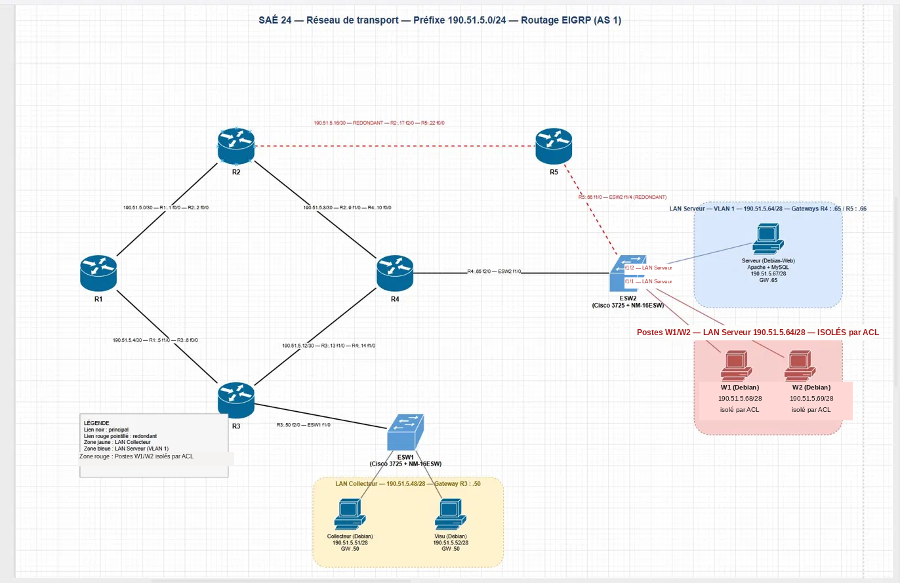
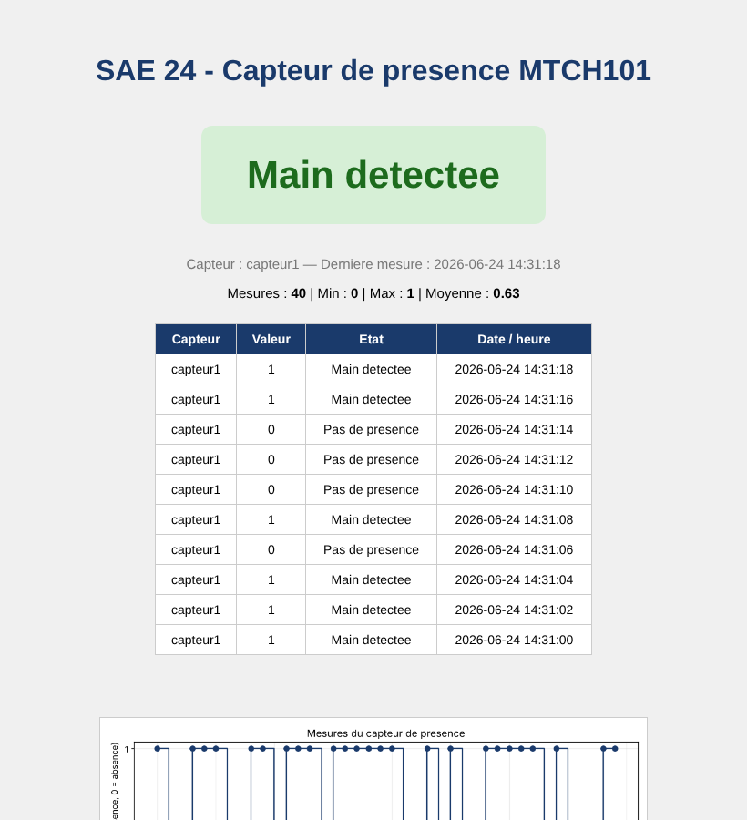
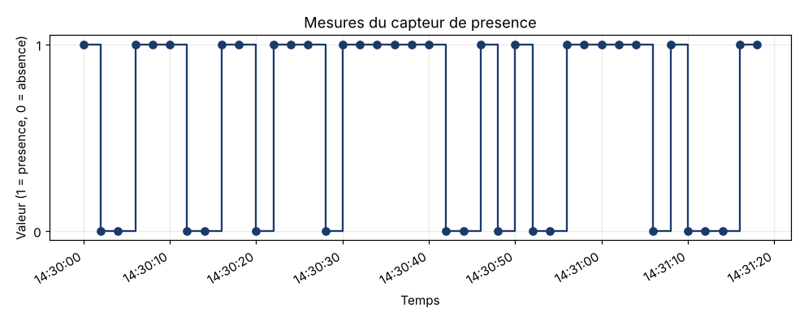

# SAÉ 24 : collecte de données d'un capteur sur un réseau sécurisé

Projet de 2e semestre du BUT Réseaux & Télécoms (IUT de Créteil-Vitry, UPEC), fait en binôme.

Le principe : un capteur de présence branché sur une Arduino envoie ses mesures en TCP à travers un réseau de 5 routeurs Cisco (EIGRP, lien de secours, ACL). Un serveur Python les range dans une base MySQL, et une page web les affiche.



*Le réseau : 5 routeurs, 2 switchs, le LAN collecteur en jaune, le LAN serveur en bleu et les postes W1/W2 en rouge (bloqués par ACL).*

La topologie telle qu'elle est montée dans GNS3 : [`docs/topologie-gns3.png`](docs/topologie-gns3.png). Le plan d'adressage est dans [`docs/plan-adressage.md`](docs/plan-adressage.md).

## Ce que ça donne

| Page web | Courbe |
|---|---|
|  |  |

La page affiche l'état du capteur (main détectée ou pas), les dernières mesures et le min / max / moyenne, et elle se rafraîchit toute seule. La courbe est tracée avec Matplotlib.

> Ces deux captures viennent d'une base remplie avec des mesures de test, pas d'une vraie séance avec l'Arduino. Le code est le même que celui du projet.

## Comment ça marche

```
Capteur MTCH101
   │  sortie active à l'état bas quand une main approche
Arduino + shield Ethernet
   │  TCP, format "capteur;valeur", port 5000
Réseau GNS3 (5 routeurs, 2 switchs, EIGRP, ACL)
   │
Serveur Debian
   ├─ serveur Python (socket) : reçoit et insère
   ├─ MySQL / MariaDB : stocke
   ├─ Python + Matplotlib : stats et courbe
   └─ Apache + PHP : page web
```

## Le réseau

- 5 routeurs Cisco c7200 et 2 switchs (EtherSwitch c3725 avec module NM-16ESW)
- Routage EIGRP (AS 1) sur 190.51.5.0/24, avec des /30 entre les routeurs et des /28 pour les LAN
- Les routeurs forment un losange (R1, R2, R4, R3), plus un lien R2-R5 pour le secours. Quand on coupe un lien, EIGRP recalcule et passe par le chemin de secours tout seul. Je l'ai testé en direct : le TTL des pings passe de 62 à 60 (le paquet traverse deux routeurs de plus) et le traceroute montre le nouveau trajet.
- Les postes W1 et W2 sont dans le même LAN que le serveur mais ne doivent pas atteindre le système de collecte. C'est une ACL sur R4 qui s'en charge. Un ping de W1 vers le collecteur répond « Communication administratively prohibited ».

## La partie info

1. `base-de-donnees/database.sql` crée la table `mesures` (id auto-incrémenté, capteur, valeur, date).
2. `serveur/serveur_tcp.py` écoute sur le port 5000, découpe `capteur;valeur` et insère avec une requête préparée.
3. `serveur/exploitation.py` calcule min, max, moyenne et trace la courbe en créneaux.
4. `web/affichage.php` affiche tout ça.

Le sujet demandait d'envoyer les données en TCP par Ethernet, donc pas de liaison série ni de pySerial pour les mesures.

## Contenu du dépôt

| Dossier | Contenu |
|---|---|
| [`configs/`](configs/) | configs Cisco des routeurs R1 à R5 et des switchs SW1, SW2 |
| [`serveur/`](serveur/) | serveur TCP et script d'exploitation |
| [`base-de-donnees/`](base-de-donnees/) | script SQL |
| [`web/`](web/) | page d'affichage et une variante d'insertion en HTTP |
| [`arduino/`](arduino/) | les deux sketchs |
| [`docs/`](docs/) | schémas, plan d'adressage, matrice de communication |

## Pour tester

Côté réseau : recréer la topologie dans GNS3, coller les configs de `configs/` sur chaque équipement, puis vérifier avec `show ip route` et `show ip eigrp neighbors`.

Côté serveur (Debian) :

```bash
sudo apt install -y apache2 mariadb-server php php-mysql libapache2-mod-php python3 python3-pip
pip3 install mysql-connector-python matplotlib

# mettre un vrai mot de passe à la place de <MOT_DE_PASSE> dans database.sql
sudo mysql < base-de-donnees/database.sql

sudo cp web/affichage.php /var/www/html/
python3 serveur/serveur_tcp.py      # laisse tourner
python3 serveur/exploitation.py     # stats et courbe
```

La page est ensuite sur `http://<ip-serveur>/affichage.php`.

Tous les mots de passe du dépôt sont remplacés par `<MOT_DE_PASSE>` : à mettre en local avant de lancer, sans les commiter.

## Ce qui m'a bloqué

- **Des VM clonées avec la même adresse MAC.** Les routeurs n'arrivaient plus à joindre les machines à cause de la table ARP. J'ai compris pourquoi la MAC doit être unique et à quoi sert `clear arp-cache`.
- **Redondance de lien et redondance de passerelle, ce n'est pas pareil.** EIGRP bascule quand un lien tombe, mais un PC n'a qu'une passerelle. Pour que tout un LAN bascule, il faudrait HSRP ou VRRP, que je n'ai pas mis en place.
- **Relier l'Arduino réelle à GNS3.** Il faut un nœud Cloud branché sur la bonne carte réseau, côté serveur local et pas côté GNS3 VM.
- **VLAN ou ACL pour isoler W1 et W2 ?** Le sujet les voulait dans le LAN du serveur, donc impossible de les mettre dans un autre VLAN. J'ai choisi l'ACL.

## Outils

Cisco IOS, EIGRP, ACL, GNS3, Python (socket, Matplotlib), MySQL / MariaDB, PHP, Apache, Debian, Arduino.

## Licence

[MIT](LICENSE)
